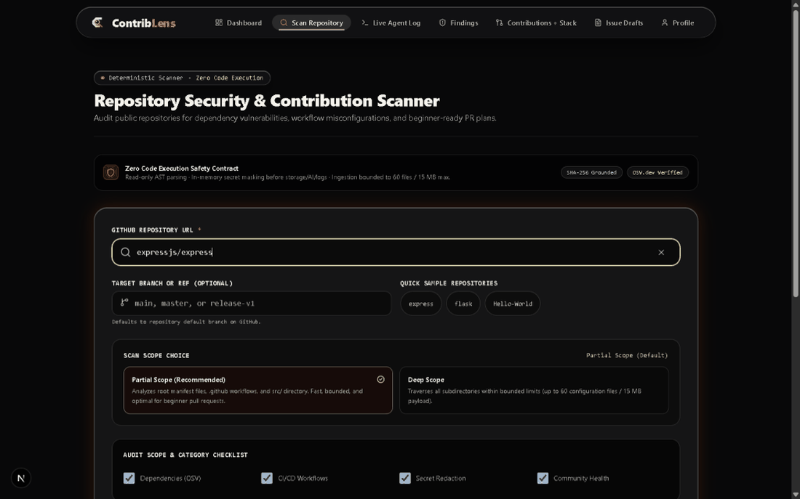
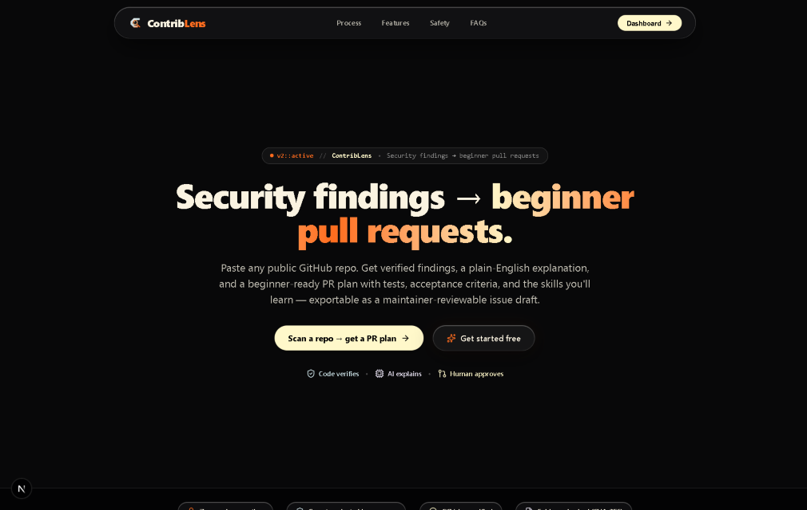
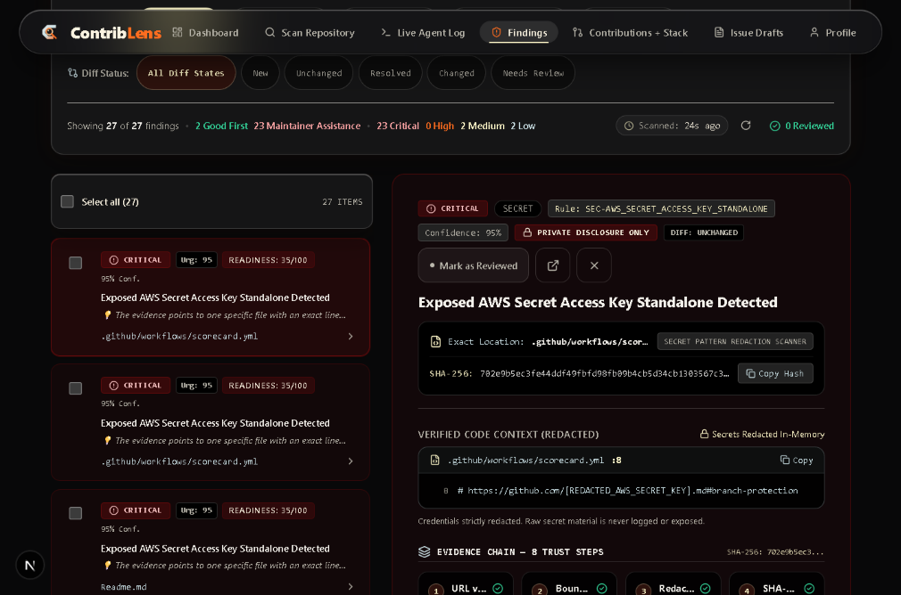
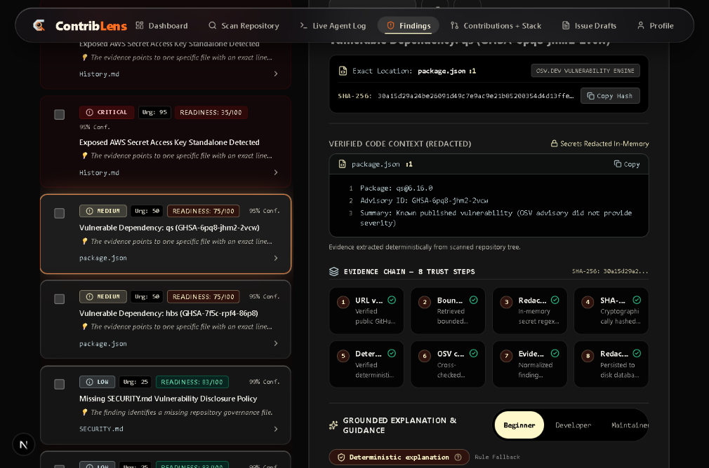
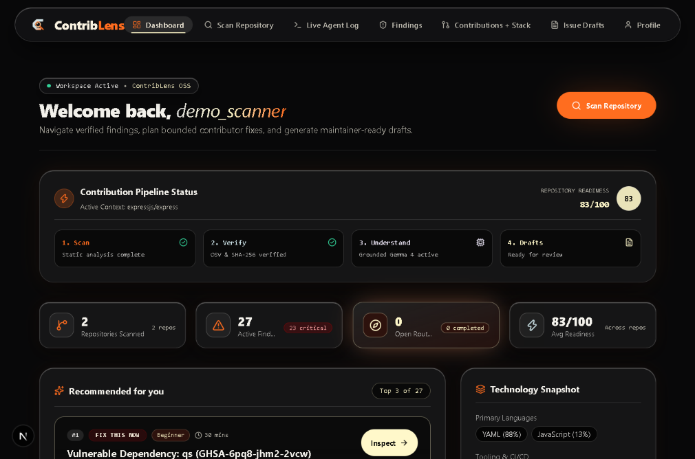
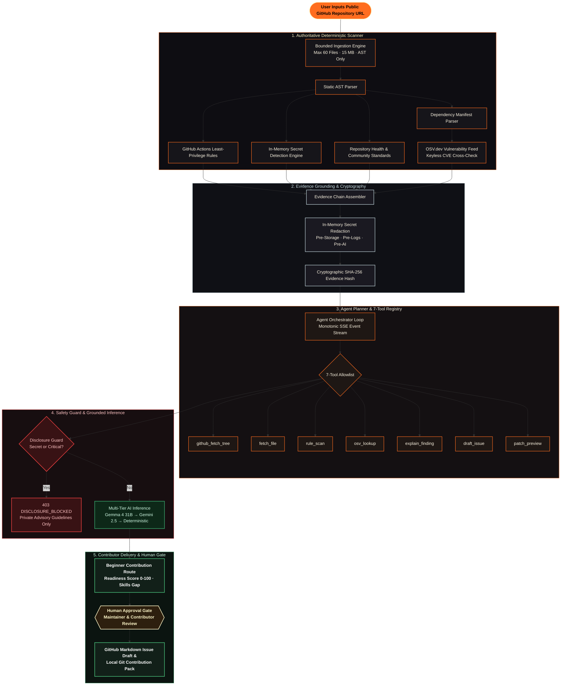
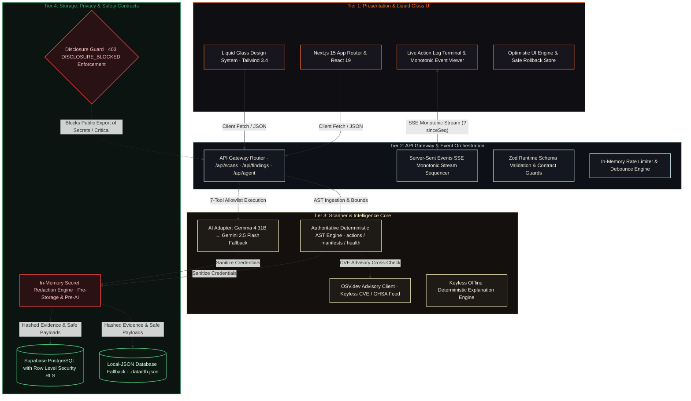

<div align="center">


# ContribLens

<p align="center">
  
</p>

<p align="center">
  <strong>AI-powered GitHub repository security scanner for beginners — turns verified findings into actionable first-contribution plans.</strong>
</p>

<p align="center">
  <a href="https://hacktoberfest-contri-blens.vercel.app/" target="_blank">
    
  </a>
  <a href="https://github.com/meoxx009/AgentXContriBLens/actions">
    
  </a>
  <a href="https://nextjs.org/">
    
  </a>
  <a href="https://react.dev/">
    
  </a>
  <a href="https://www.typescriptlang.org/">
    
  </a>
  <a href="LICENSE">
    
  </a>
</p>

<p align="center">
  <a href="#-quick-start-zero-config">Quick Start</a> •
  <a href="#-visual-walkthrough">Visual Walkthrough</a> •
  <a href="#-why-contriblens">Why ContribLens</a> •
  <a href="#-core-capabilities">Core Capabilities</a> •
  <a href="#-pipeline-flowchart">Pipeline Flowchart</a> •
  <a href="#-system-architecture">Architecture</a> •
  <a href="#-security--safety-contract">Security & Safety</a> •
  <a href="https://hacktoberfest-contri-blens.vercel.app/">Live Webapp ↗</a>
</p>

</div>

---

## ⚡ Visual Walkthrough

Experience the complete ContribLens flow: from entering a repository URL, through the bounded deterministic scanner and grounding engine, to a beginner-ready pull request plan.

<div align="center">
  <p><strong>0. Interactive Scan Flow in Action</strong></p>
  
  <p><em>Real-time audit: repository input → 6-stage pipeline → Contribution Readiness scoring → beginner PR plan details.</em></p>
</div>

<br />

<div align="center">
  <p><strong>1. Landing Hero & Liquid Glass Material System</strong></p>
  
  <p><em>Smoky ambient background with liquid glass navigation capsule, trust indicators, and core philosophy.</em></p>
</div>

<br />

<div align="center">
  <table>
    <tr>
      <td width="50%" align="center">
        <strong>2. Bounded Repository Scanner</strong><br /><br />
        <br />
        <sub>Strict read-only ingestion bounded to 60 files / 15 MB payload with scope choices.</sub>
      </td>
      <td width="50%" align="center">
        <strong>3. Contribution Readiness Scoring</strong><br /><br />
        <br />
        <sub>Multi-factor scoring (0–100) separating urgency from difficulty, with scan diff tracking.</sub>
      </td>
    </tr>
    <tr>
      <td width="50%" align="center">
        <strong>4. Grounded Explanation & Beginner PR Plan</strong><br /><br />
        <br />
        <sub>3-part explanation (What, Why, Fix), verified SHA-256 evidence, and curated learning skills.</sub>
      </td>
      <td width="50%" align="center">
        <strong>5. Contributor Workspace & Scan History</strong><br /><br />
        <br />
        <sub>Unified workspace showing active pipeline status, readiness trends, and prioritized PR recommendations.</sub>
      </td>
    </tr>
  </table>
</div>

---

## 🎯 Why ContribLens?

Open-source maintainers face burnout from triage backlogs, while aspiring contributors want to contribute but are intimidated by monolithic codebases and unclear issues. Existing security tools dump overwhelming SAST reports without showing a beginner how to fix them.

| The Problem Today | The ContribLens Solution |
| :--- | :--- |
| **Monolithic Codebase Friction** — Beginners don't know where to start or which files are safe to touch. | **Bite-Sized PR Plans** — Turns static hygiene findings into targeted 1-to-2 file routes with step-by-step test plans and acceptance criteria. |
| **Maintainer Triage Fatigue** — Low-effort AI pull requests create noise and increase review overhead. | **Human Approval Gate** — Zero autonomous publishing. All issue drafts and routes require explicit contributor review and maintainer approval. |
| **Scanner Hallucinations & Noise** — LLM-only scanners invent vulnerabilities that do not exist. | **Authoritative Deterministic Scanner** — Code verifies first. AST rules and OSV.dev advisories ground every finding with a cryptographic SHA-256 evidence hash. |
| **Accidental Secret Disclosure** — Beginners mistakenly open public issues describing credential leaks. | **Automated Disclosure Guard** — Secrets and critical findings are strictly quarantined (`403 DISCLOSURE_BLOCKED`) with guided private reporting. |

> **Core Invariant:** `Code verifies. AI explains. Human approves.`

---

## 🚀 Core Capabilities

### 1. Deterministic Static Scanner (`src/lib/scanner/`)
ContribLens scans public repositories statically and read-only without executing any code. Ingestion is bounded to **60 files / 15 MB payload** with strict timeout protection.

* **GitHub Actions Workflows (`actions.ts`)**: Detects overly permissive `GITHUB_TOKEN` scopes, missing top-level `permissions:` blocks, unpinned action SHAs (`uses: actions/checkout@v4` vs immutable 40-character commit hashes), and script injection via pull request payloads.
* **Dependency Manifests & OSV.dev (`manifests.ts` & `osv.ts`)**: Cross-references `package.json`, `requirements.txt`, `go.mod`, `pom.xml`, and `Cargo.toml` with the real OSV.dev vulnerability database without requiring an API key.
* **Secret Redaction & Exposure Guard (`redaction.ts`)**: Detects high-entropy credentials, private keys, PATs, and cloud keys, sanitizing all secrets **in-memory** before storage, logs, or AI prompting.
* **Repository Health (`health.ts`)**: Audits presence of `SECURITY.md`, `CODE_OF_CONDUCT.md`, `CONTRIBUTING.md`, issue templates, and license adherence.

### 2. Autonomous Agent Orchestration (`src/lib/agent/`)
An agentic execution engine built with a strict **7-tool validated registry**:

| Tool Identifier | Scope & Invariant |
| :--- | :--- |
| `github_fetch_tree` | Recursively inspects repo hierarchy within bounded tree size (up to 20,000 entries). |
| `fetch_file` | Read-only fetch of candidate configuration files (bounded to 180 KB per file). |
| `rule_scan` | Triggers the deterministic static rule engine against parsed AST content. |
| `osv_lookup` | Queries OSV.dev API for known CVEs/GHSAs for declared dependencies. |
| `explain_finding` | Generates 3-part structured explanations (*What happened*, *Why it matters*, *How to fix*). |
| `draft_issue` | Compiles an 8-section maintainer-reviewable issue draft with Disclosure Guard validation. |
| `patch_preview` | Constructs unified diff preview for beginner review before branch creation. |

### 3. Real-Time Action Log & Event Streaming
* Server-Sent Events (SSE) stream via `/api/agent/run/[runId]/events` with monotonic sequence numbers (`seq: 1, 2, 3...`).
* Seamless client reconnection recovery: replays missed actions using `?sinceSeq=` cursor without duplicate tool executions.
* Infinite loop protection: terminates repeated identical tool calls automatically.

### 4. Cross-Session Memory & Diff Engine
* Tracks repository scan evolution over time: identifies **New**, **Unchanged**, and **Resolved** findings.
* Persists contributor learning milestones and completed checklist items across sessions.

### 5. Multi-Tier AI Explanation Hierarchy
* **Tier 1 (Primary)**: Google DeepMind `gemma-4-31b-it` for nuanced, grounded security explanations.
* **Tier 2 (Fallback)**: `gemini-2.5-flash` for high-throughput responses.
* **Tier 3 (Keyless Offline)**: Authoritative deterministic rule engine. Works 100% offline with zero API keys required.
* Transparent UI badges display exactly which engine generated each explanation.

---

## 🔄 Pipeline Flowchart

The animated, styled diagram below illustrates the end-to-end data pipeline from public repository URL to verified beginner pull request:



---

## 🏛️ System Architecture

ContribLens uses a clean 4-tier modular architecture designed for failure isolation and real-time execution:



---

## 💻 Tech Stack

| Layer | Technology | Purpose in ContribLens |
| :--- | :--- | :--- |
| **Frontend Framework** | [Next.js 15](https://nextjs.org/) (App Router) | High-performance React Server Components and nested route layouts |
| **Core UI Library** | [React 19](https://react.dev/) | Concurrent rendering, optimistic state transitions, and server actions |
| **Language & Types** | [TypeScript 5](https://www.typescriptlang.org/) | Strict compilation (`strict: true`), zero untyped `any` leaks |
| **Styling & Theme** | [Tailwind CSS 3.4](https://tailwindcss.com/) | Custom liquid glass design system, 12-token dark palette, smoky ambient background |
| **AI Inference** | [Google DeepMind Gemma 4 31B](https://ai.google.dev/gemma/docs) | Server-side structured explanation generation (`gemma-4-31b-it`) |
| **Fallback AI** | [Gemini 2.5 Flash](https://ai.google.dev/) | High-speed fallback when primary model is rate-limited |
| **Database & Auth** | [Supabase](https://supabase.com/) | PostgreSQL with Row-Level Security (RLS) + GitHub OAuth & email auth |
| **Local Fallback DB** | Atomic JSON Engine | Zero-dependency file persistence in `.data/` for local standalone dev |
| **Vulnerability Feed** | [OSV.dev API](https://osv.dev/) | Keyless Open Source Vulnerability advisory lookups for manifests |
| **Testing Engine** | [Vitest 3.0](https://vitest.dev/) | 57 test files, **701 automated unit, integration, and security tests** |
| **Schema Validation** | [Zod 3.24](https://zod.dev/) | Runtime contract validation for all API inputs, tool payloads, and AI outputs |

---

## ⚡ Quick Start (Zero-Config)

ContribLens works out of the box with **zero required external keys** using its built-in deterministic scanner and local JSON database.

### 1. Clone & Install

```bash
# Clone the repository
git clone https://github.com/meoxx009/AgentXContriBLens.git
cd AgentXContriBLens

# Install dependencies
npm install
```

### 2. Run the Development Server

```bash
npm run dev
```

Open [http://localhost:3000](http://localhost:3000) in your browser. Create an account, log in, and scan any public GitHub repository (e.g. `expressjs/express`, `pallets/flask`).

---

## ⚙️ Environment Variables

To enable Google Gemma/Gemini live AI inference, Supabase cloud sync, and 5,000 req/hr GitHub API limits, create `.env.local`:

```bash
cp .env.example .env.local
```

| Variable | Scope | Required | Description |
| :--- | :--- | :---: | :--- |
| `NEXT_PUBLIC_APP_URL` | Client/Server | No | Application host URL (default: `http://localhost:3000`) |
| `JWT_SECRET` | Server-only | Yes | Secret key for signing session tokens (fallback provided for dev) |
| `GEMINI_API_KEY` | Server-only | No | Google AI Studio key for live Gemma 4 / Gemini models |
| `GEMINI_MODEL` | Server-only | No | Primary model ID (default: `gemma-4-31b-it`) |
| `GITHUB_TOKEN` | Server-only | No | Read-only GitHub PAT (increases API rate limit from 60 to 5,000 req/hr) |
| `NEXT_PUBLIC_SUPABASE_URL` | Client/Server | No | Supabase project URL (falls back to `.data/` if omitted) |
| `NEXT_PUBLIC_SUPABASE_ANON_KEY` | Client/Server | No | Supabase public anonymous API key |
| `SUPABASE_SERVICE_ROLE_KEY` | Server-only | No | Supabase administrative service role key |
| `SCAN_MAX_FILES` | Server-only | No | Maximum candidate files analyzed per scan (default: `60`) |
| `SCAN_MAX_FILE_BYTES` | Server-only | No | Maximum individual file size in bytes (default: `180000` / 180 KB) |
| `SCAN_MAX_TOTAL_BYTES` | Server-only | No | Maximum total payload bytes ingested (default: `15728640` / 15 MB) |
| `SCAN_MAX_TREE_ENTRIES` | Server-only | No | Maximum repository tree entries parsed (default: `20000`) |

> [!IMPORTANT]
> All credentials (`GEMINI_API_KEY`, `GITHUB_TOKEN`, `SUPABASE_SERVICE_ROLE_KEY`) are quarantined server-side. Zero secret keys are exposed to the browser.

---

## 📂 Project Structure

```
src/
├── app/                                 # Next.js 15 App Router Routes
│   ├── api/                             # Internal REST API & SSE Endpoints
│   │   ├── agent/run/                   # 7-Tool Agent Orchestration & SSE Event Stream
│   │   ├── ai/plan/                     # Grounded Plan & Route Generation Engine
│   │   ├── auth/                        # Session, Login, Signup, GitHub OAuth, Refresh
│   │   ├── drafts/                      # Maintainer-Reviewable Issue Drafts
│   │   ├── findings/                    # Findings API & AI Finding Suggestions
│   │   ├── routes/                      # Contribution Routes & Markdown Pack Downloads
│   │   ├── scans/                       # Bounded Ingestion & Scan History Endpoints
│   │   └── stats/                       # Public Aggregated Platform Counters
│   ├── app/                             # Authenticated Contributor Portal
│   │   ├── agent/                       # Live Agent Action Log Terminal View
│   │   ├── contributions/               # Contribution Routes & Skills Gap Tracker
│   │   ├── dashboard/                   # High-Level Metric Cards & Recent Scans
│   │   ├── findings/                    # Verified Findings List & Detail Panel
│   │   ├── issue-drafts/                # Drafts Editor with Disclosure Guard
│   │   ├── profile/                     # Contributor Settings & Data Export/Clear
│   │   └── scan/                        # Repository Input with Branch Resolution
│   └── page.tsx                         # Landing Page with Hero & Feature Grid
├── components/                          # UI Components & Glass Material System
│   ├── views/                           # Screen Views (ScanView, FindingsView, etc.)
│   ├── AppContext.tsx                   # Central Application State & Navigation Store
│   └── NavigationCapsule.tsx            # Floating Liquid Glass Navigation Bar
├── lib/                                 # Business Logic, Utilities & Engine Core
│   ├── agent/                           # Autonomous Agent Engine
│   │   ├── orchestrator.ts              # Agent Loop, Guardrails & Replanning
│   │   ├── planner.ts                   # Step Generation & Task Decomposition
│   │   ├── run-manager.ts               # SSE Monotonic Event Sequencer & Storage
│   │   └── tools.ts                     # Strict 7-Tool Zod-Validated Registry
│   ├── scanner/                         # Authoritative Deterministic Scanner
│   │   ├── actions.ts                   # GitHub Actions Least-Privilege Rules
│   │   ├── diff.ts                      # Scan Fingerprint & Diff Comparison Engine
│   │   ├── evidence.ts                  # Cryptographic SHA-256 Grounded Evidence
│   │   ├── explanations.ts              # 3-Part Grounded Explanation Builder
│   │   ├── github.ts                    # Bounded GitHub API Client with Cache
│   │   ├── health.ts                    # Community Standards & Repository Health
│   │   ├── manifests.ts                 # Dependency Manifest AST Parsers
│   │   ├── osv.ts                       # OSV.dev Keyless Vulnerability Client
│   │   ├── readiness.ts                 # Contribution Readiness Scoring (0-100)
│   │   └── tech-detector.ts             # Language & Framework Stack Identification
│   ├── db.ts                            # Unified Database Adapter (Supabase + Local JSON)
│   ├── gemini.ts                        # Multi-Tier AI Provider (Gemma 4 / Gemini 2.5)
│   └── redaction.ts                     # In-Memory Secret Redaction Engine
└── styles/                              # Tailwind Design Tokens & Global CSS
```

---

## 🛡️ Security & Safety Contract

ContribLens adheres to non-negotiable security principles to safeguard users and target repositories:

* **Zero Code Execution**: Scanned repositories are strictly parsed as static AST structures. ContribLens never clones, evaluates, runs scripts, or installs packages from scanned repos.
* **In-Memory Secret Redaction**: Detected passwords, cloud credentials, tokens, and authorization headers are immediately masked before disk storage, logging, or AI model prompting.
* **Cryptographic Evidence Hashing**: Every finding is backed by an immutable SHA-256 digest of the exact evidence snippet.
* **Authoritative Severity Rule**: Scanner rules own severity unconditionally (`CRITICAL`, `HIGH`, `MEDIUM`, `LOW`, `INFO`). AI models cannot alter or downgrade severities.
* **Automated Disclosure Guard**: Findings with exposed credentials or critical severity strictly block public issue draft creation (`403 DISCLOSURE_BLOCKED`). ContribLens guides the user to report securely via private security advisories.
* **Human Approval Gate**: ContribLens produces guidance, routes, and drafts. It never automatically creates public GitHub pull requests or issues.

---

## 🧪 Verification & Quality Gate

ContribLens maintains complete test coverage across its deterministic scanner, agent loop, and user interface:

```bash
# Run strict TypeScript compiler typecheck
npm run typecheck

# Run ESLint across entire codebase
npm run lint

# Run all 701 automated unit & integration tests
npm test

# Build optimized Next.js production bundle
npm run build

# Check live integration health (Supabase, OSV.dev, AI inference)
npm run check:integrations
```

**Test Suite Results:**
```text
Test Files  57 passed (57)
     Tests  701 passed (701)
  Duration  187s
```

---

## 📚 Documentation Index

| Documentation File | Description & Focus |
| :--- | :--- |
| [`PRD.md`](PRD.md) | Product Requirements Document: user personas, pain points, and workflows |
| [`DESIGN.md`](DESIGN.md) | Visual Design System: locked 12-token palette, liquid glass components, layout specs |
| [`ARCHITECTURE.md`](ARCHITECTURE.md) | 4-tier system architecture, data flow pipelines, and failure isolation boundaries |
| [`ROUTES_AND_STATES.md`](ROUTES_AND_STATES.md) | Application route hierarchy, view states (loading, empty, error, success), and state machines |
| [`EVIDENCE_AND_SCHEMAS.md`](EVIDENCE_AND_SCHEMAS.md) | Formal JSON evidence schemas, AI explanation contracts, and validation rules |
| [`SCANNER_RULES.md`](SCANNER_RULES.md) | Deterministic static analysis rules for GitHub Actions, secrets, manifests, and repo health |
| [`DATABASE.md`](DATABASE.md) | Database architecture: Supabase PostgreSQL schema, RLS policies, and local JSON storage |
| [`API_INTEGRATION.md`](API_INTEGRATION.md) | Internal REST API routes, provider adapters, error specifications, and response formats |
| [`SECURITY.md`](SECURITY.md) | Threat model, defense-in-depth mitigations, secret handling, and disclosure guard |
| [`SKILL.md`](SKILL.md) | Engineering standards, coding invariants, and architectural guidelines |
| [`IMPLEMENTATION.md`](IMPLEMENTATION.md) | Phase-by-phase implementation plan and release checklist |
| [`docs/handoff-g-series.md`](docs/handoff-g-series.md) | Comprehensive G-Series validation report, test records, and handoff audit |

---

## 🤝 Contributing

We welcome contributions to ContribLens! Follow these steps to submit your changes:

1. **Fork the Repository** on GitHub.
2. **Create a Feature Branch**:
   ```bash
   git checkout -b feature/awesome-new-rule
   ```
3. **Make Your Changes** adhering to the locked design tokens and security invariants.
4. **Ensure All Gates Pass**:
   ```bash
   npm run lint && npm run typecheck && npm test && npm run build
   ```
5. **Commit Your Work**:
   ```bash
   git commit -m "feat: add rule for unpinned docker container actions"
   ```
6. **Push to GitHub & Open a Pull Request**.

---

## 📄 License

This project is licensed under the [MIT License](LICENSE) © 2026 meoxx009.

---

<div align="center">
  <sub>Built with precision for <strong>AgentX Hackathon 2026</strong>. Grounded in evidence. Designed for beginners.</sub>
</div>
